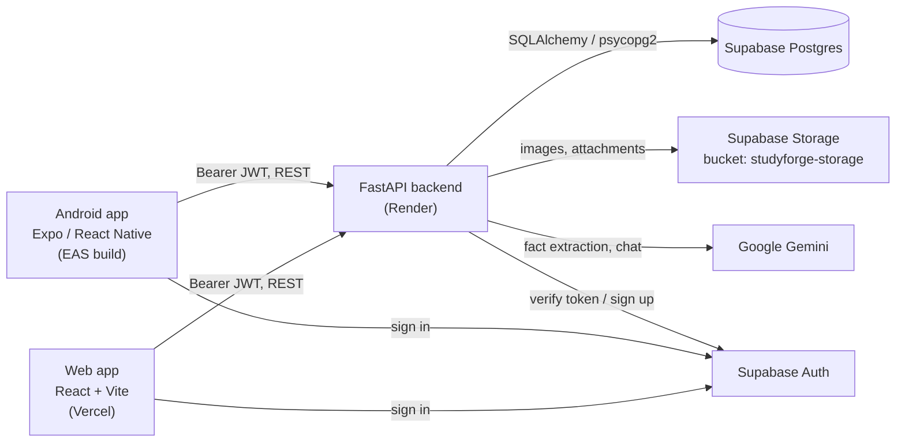

# Folio

Folio turns your raw study material into clean, structured notes you can read, edit and ask questions about. You upload a PDF, slide deck, Word document, Markdown file or image. The backend parses it and stores it as Markdown, and Gemini extracts key facts into a personal knowledge base. You can then study the note on the web or on Android, with math, code highlighting, embedded images, attachments and an AI chat that knows the note you're looking at.

- Web app: https://folio-three-coral.vercel.app
- Backend: FastAPI on Render
- Mobile: Expo / React Native Android app built with EAS

## Table of contents

- [Features](#features)
- [Architecture](#architecture)
- [Tech stack](#tech-stack)
- [Repository structure](#repository-structure)
- [API reference](#api-reference)
- [Data model](#data-model)
- [Image handling](#image-handling)
- [Authentication](#authentication)
- [Environment variables](#environment-variables)
- [Local setup](#local-setup)
- [Tests, typecheck and lint](#tests-typecheck-and-lint)
- [Deployment](#deployment)
- [Performance notes](#performance-notes)
- [Troubleshooting](#troubleshooting)
- [Known limitations and roadmap](#known-limitations-and-roadmap)
- [Contributing](#contributing)
- [License](#license)

## Features

Shared across web and mobile:

- Upload `.pdf`, `.pptx`, `.docx`, `.md`, plain text and image files (the full list is `SUPPORTED_EXTENSIONS` in `Backend/app/services/document_parser.py`).
- Markdown study notes that render KaTeX math, syntax-highlighted code blocks and embedded images.
- A library of folders. Folders can be pinned, renamed and deleted, with an option to keep their notes. Notes can also stay unassigned.
- An AI chat with Gemini, scoped to the current note. You can attach images or text files to a message, and chat history is saved per session.
- A knowledge base of concept/description/tag facts that Gemini extracts from each upload in the background.
- Per-note attachments (upload, rename, delete) stored in Supabase Storage.
- A note switcher for jumping between notes in the same folder.
- In-place note editing, with conflict detection when the note changed on the server.

Web only:

- Pages for Home, Library, Upload, Study (note + chat), Study Chats, Knowledge Base and Settings, all loaded as lazy route chunks.

Mobile only:

- An offline cache backed by `react-native-mmkv` (`Mobile/src/cache.ts`). Notes you've opened before load instantly and stay readable without a connection.
- Notes render in a WebView, and the theme is stored on the device.

## Architecture



Both clients sign in directly with Supabase Auth and send the access token to the backend as `Authorization: Bearer <token>`. The backend owns all application data. It writes rows to Postgres through SQLAlchemy, stores binary files in Supabase Storage and calls Gemini for fact extraction and chat.

## Tech stack

| Layer | Technology |
| --- | --- |
| Backend | Python, FastAPI 0.138, Uvicorn, SQLAlchemy 2.0 + psycopg2-binary, Pydantic 2 |
| Document parsing | PyMuPDF, python-pptx, python-docx, Pillow |
| AI | Google Gemini via `google-genai` (default model `gemini-2.5-flash`, can be overridden with `GEMINI_MODEL`) |
| Data / auth / files | Supabase Postgres, Supabase Auth, Supabase Storage (`supabase` 2.11) |
| Web | React 19, Vite 8, TypeScript 6, Tailwind CSS 4, Zustand, react-markdown, `@supabase/supabase-js` |
| Mobile | Expo SDK 56, React Native 0.85, Expo Router, NativeWind 4 (Tailwind 3), Zustand, react-native-mmkv |
| Hosting | Render (backend), Vercel (web), EAS Build (Android APK) |

## Repository structure

```text
Folio/
├── Backend/                 FastAPI service
│   ├── app/
│   │   ├── main.py          App entry: CORS, routers, startup sweep, /api/status
│   │   ├── api/             Mounted routers: library, upload, auth, chat
│   │   ├── models/          SQLAlchemy models (schema.py), DB engine, Pydantic schemas
│   │   ├── services/        ai_pipeline, document_parser, image_extraction (+ dormant modules)
│   │   ├── utils/           auth_deps (JWT), supabase_client, limits
│   │   ├── prompts/ config/ renderers/   Support files for the generation pipeline
│   └── requirements.txt
├── Frontend/                React + Vite web app (deployed to Vercel)
│   ├── src/pages/           Route screens (Home, Library, Study, Upload, ...)
│   ├── src/components/      Shared UI
│   ├── src/api.ts           Backend client
│   ├── src/supabase.ts      Supabase client
│   └── vercel.json
├── Mobile/                  Expo / React Native Android app
│   ├── app/                 Expo Router routes: index, auth, library/, note/, settings/
│   ├── src/                 API client, MMKV cache, stores, components
│   ├── app.json
│   └── eas.json             EAS build profiles (development, preview, production)
├── docs/                    Context log and pipeline decisions
├── AGENTS.md                Contributor / agent guidance
└── README.md
```

`Backend/app/services` also has modules from an older generation pipeline (planning, chunking, revision and others). `main.py` doesn't mount any router that uses them, so this README doesn't document them as features.

## API reference

Every route except `/`, `/api/status` and `/api/auth/signup` needs `Authorization: Bearer <Supabase access token>`, which `get_current_user_id` in `Backend/app/utils/auth_deps.py` resolves to a user.

| Method | Path | Auth | Purpose |
| --- | --- | --- | --- |
| GET | `/` | No | Welcome message |
| GET | `/api/status` | No | Health check |
| POST | `/api/auth/signup` | Invite code | Create a Supabase user when `secret_code` matches `INVITE_CODE` |
| POST | `/api/upload` | Yes | Upload and parse a document into a note. Fact extraction runs in the background |
| GET | `/api/files` | Yes | List notes (summaries) |
| GET | `/api/files/unassigned` | Yes | List notes that aren't in a folder |
| GET | `/api/files/{file_id}` | Yes | Get a note with its full Markdown |
| PUT | `/api/files/{file_id}` | Yes | Update a note (name, folder, Markdown). Returns 409 if the hash doesn't match |
| DELETE | `/api/files/{file_id}` | Yes | Delete a note |
| GET | `/api/folders` | Yes | List folders |
| POST | `/api/folders` | Yes | Create a folder |
| PUT | `/api/folders/{folder_id}` | Yes | Rename, recolor or pin a folder |
| DELETE | `/api/folders/{folder_id}?keep_notes=true` | Yes | Delete a folder, optionally keeping its notes |
| GET | `/api/folders/{folder_id}/files` | Yes | List the notes in a folder |
| GET | `/api/facts` | Yes | Knowledge-base facts |
| POST | `/api/files/{file_id}/attachments` | Yes | Upload an attachment to a note |
| GET | `/api/files/{file_id}/attachments` | Yes | List a note's attachments |
| PUT | `/api/attachments/{attachment_id}` | Yes | Rename an attachment |
| DELETE | `/api/attachments/{attachment_id}` | Yes | Delete an attachment |
| POST | `/api/chat` | Yes | Send a chat message (optionally with attachments) to Gemini |
| POST | `/api/chat/context` | Yes | Set or refresh the note context for a chat |
| GET | `/api/chat/history` | Yes | List chat sessions |

FastAPI also serves interactive docs at `/docs` (Swagger UI) and `/redoc`, since `main.py` doesn't turn them off.

## Data model

The tables are defined in `Backend/app/models/schema.py` and created with `Base.metadata.create_all` at startup. All primary keys are integers.

| Table | Key columns |
| --- | --- |
| `User` | `id`, `username` (unique), `email` (unique), `created_at` |
| `Folder` | `id`, `user_id`, `name`, `color`, `is_pinned`, `created_at` |
| `File` (a note) | `id`, `user_id`, `folder_id` (nullable = unassigned), `name`, `original_filename`, `file_size`, `markdown_content`, `status` (`pending` / `processing` / `complete` / `failed`), `created_at` |
| `Fact` | `id`, `file_id`, `concept`, `description`, `tags` (comma-separated), `created_at` |
| `Attachment` | `id`, `file_id`, `filename`, `file_type`, `file_size`, `storage_path`, `created_at` |
| `ChatSession` | `id`, `user_id`, `title`, `subject`, `history` (JSON text), `messages_count`, `created_at`, `updated_at` |

Users are matched to Supabase Auth by email. The backend looks up, or creates, the local `User` row for the email in the verified token.

## Image handling

Parsed documents and edited notes can contain images as inline base64 `data:` URIs. Storing those in `markdown_content` would make every note payload huge. So on upload and on save, `extract_inline_images` (`Backend/app/services/image_extraction.py`) does three things:

1. Finds each `data:image/...;base64,...` URI in the Markdown.
2. Decodes it and uploads it to the `studyforge-storage` Supabase bucket, recording an `Attachment` row.
3. Replaces the URI with the object's public URL.

The note ends up holding plain Markdown image links, which both clients render as normal images.

## Authentication

1. Signing up goes through the backend, at `POST /api/auth/signup`. The request must include a `secret_code` equal to the server's `INVITE_CODE`. If it doesn't match, or `INVITE_CODE` isn't set, the server returns `403`.
2. Signing in happens on the client with `@supabase/supabase-js`, which returns a Supabase access token (JWT).
3. On each request, `auth_deps.py` verifies the bearer token:
   - If `SUPABASE_JWT_SECRET` is set and the token is HS256, it's verified locally with no network call.
   - Otherwise the backend falls back to `supabase.auth.get_user`.
   - The token → email and email → user id lookups are both cached for up to 5 minutes, never past the token's own expiry.

## Environment variables

Don't commit real values. Each app reads a local `.env` during development.

### Backend (`Backend/.env`, Render environment)

| Variable | Required | Description |
| --- | --- | --- |
| `DATABASE_URL` | Yes | Supabase Postgres connection string. `postgres://` and `postgresql://` are rewritten to `postgresql+psycopg2://` |
| `SUPABASE_URL` | Yes | Supabase project URL |
| `SUPABASE_KEY` | Yes | Supabase key the backend uses for auth and storage calls (a service-role key is assumed, since the backend writes to storage. Not verified here) |
| `GEMINI_API_KEY` | Yes | Google Gemini API key |
| `GEMINI_MODEL` | No | Overrides the default `gemini-2.5-flash` |
| `INVITE_CODE` | Yes | Code users must enter to sign up. If it's unset, signup is closed |
| `CORS_ORIGINS` | Yes in production | Comma-separated exact origins with no trailing slash, e.g. `https://folio-three-coral.vercel.app`. Defaults to `http://localhost:3000,http://localhost:5173,http://localhost:8081`. `*` is ignored |
| `SUPABASE_JWT_SECRET` | No | Enables local HS256 token verification |

### Frontend (`Frontend/.env`, Vercel environment)

| Variable | Required | Description |
| --- | --- | --- |
| `VITE_API_URL` | Yes | Backend base URL |
| `VITE_SUPABASE_URL` | Yes | Supabase project URL |
| `VITE_SUPABASE_ANON_KEY` | Yes | Supabase anon key (the code also accepts `VITE_SUPABASE_ANON`) |

### Mobile (`Mobile/.env`, EAS environment)

| Variable | Required | Description |
| --- | --- | --- |
| `EXPO_PUBLIC_API_URL` | Yes | Backend base URL |
| `EXPO_PUBLIC_SUPABASE_URL` | Yes | Supabase project URL |
| `EXPO_PUBLIC_SUPABASE_ANON_KEY` | Yes | Supabase anon key (the code also accepts `EXPO_PUBLIC_SUPABASE_ANON`) |

EAS cloud builds don't read your local `.env`. Register each variable for the build environment:

```bash
eas env:create --name EXPO_PUBLIC_API_URL --value https://<your-backend>.onrender.com --environment preview --visibility plaintext
```

Repeat that command for each variable. Pick `--visibility` to suit the value.

## Local setup

Prerequisites: Python 3.11+ (the repo's bytecode was built with 3.13), Node.js 20+, a Supabase project and a Gemini API key.

### Backend

```bash
cd Backend
python -m venv venv
# Windows (PowerShell)
venv\Scripts\Activate.ps1
# macOS / Linux
source venv/bin/activate
pip install -r requirements.txt
python -m uvicorn app.main:app --reload
```

The API runs at `http://localhost:8000` (docs at `/docs`).

### Web

```bash
cd Frontend
npm install
npm run dev
```

The web app runs at `http://localhost:5173`.

### Mobile

```bash
cd Mobile
npm install
npx expo start
```

On a physical phone, `localhost` refers to the phone itself. Set `EXPO_PUBLIC_API_URL` to your machine's LAN IP or to the deployed backend.

## Tests, typecheck and lint

| App | Command | What it does |
| --- | --- | --- |
| Frontend | `npm run build` | `tsc -b` typecheck followed by `vite build` |
| Frontend | `npm run lint` | `oxlint` |
| Mobile | `npm run typecheck` | `tsc --noEmit` |

The backend has no automated test suite. The `test_*.py` scripts in `Backend/` are manual scripts for the older pipeline.

## Deployment

### Backend on Render

- Root directory: `Backend`
- Build command: `pip install -r requirements.txt`
- Start command: `uvicorn app.main:app --host 0.0.0.0 --port $PORT`
- Set the backend environment variables listed above, including `INVITE_CODE` and `CORS_ORIGINS`.

### Web on Vercel

Import the repo with `Frontend` as the root directory. Vercel detects Vite automatically (build `npm run build`, output `dist`). `Frontend/vercel.json` holds the SPA routing config. Set the `VITE_*` variables, then redeploy whenever they change, because Vite inlines them at build time.

### Android with EAS

```bash
cd Mobile
npm install -g eas-cli
eas login
eas build -p android --profile preview
```

The `preview` profile builds an installable APK for internal distribution. Set the `EXPO_PUBLIC_*` variables with `eas env:create` before building.

## Performance notes

These changes went in during the optimization passes:

- Mobile: the note WebView throttles its scroll events, so the JS bridge isn't flooded while reading.
- Web: routes are split with `React.lazy`, so each screen loads as its own chunk.
- Backend: the heavy routes are sync `def` handlers, which FastAPI runs in its threadpool. Blocking DB, parsing and storage calls don't stall the event loop.
- Chat: only the last few turns of history (`CHAT_HISTORY_TURNS`) are sent to Gemini, along with the note context. Output is capped at 8192 tokens.
- Saving: note updates return a slim response with a `content_hash` instead of echoing the full Markdown back.
- Auth: local JWT verification and 5-minute caches remove a Supabase round trip from most requests.

## Troubleshooting

| Symptom | Cause / fix |
| --- | --- |
| Browser shows a CORS error against the Render backend | `CORS_ORIGINS` has to match the origin exactly. Use `https://folio-three-coral.vercel.app` with no trailing slash, then redeploy the service |
| `ModuleNotFoundError: psycopg` or a driver error on startup | SQLAlchemy 2.1 defaults `postgresql://` to psycopg v3. The repo pins `SQLAlchemy==2.0.51` with `psycopg2-binary`, and `database.py` forces `postgresql+psycopg2://`. Keep both |
| The APK tries to reach `your-project.supabase.co`, or login fails on the phone | The EAS build didn't get `EXPO_PUBLIC_*` variables, so it used placeholders. Add them with `eas env:create` and rebuild |
| Signup returns `403` | The invite code is wrong, or `INVITE_CODE` isn't set on the server |
| The first request takes 30+ seconds or times out | The free Render instance is waking from a cold start. Retry, or ping `/api/status` first |
| A note stays in "processing" forever | Notes stuck in `processing` for over 15 minutes are marked failed when the app starts and by the library sweep. Re-upload the file |
| Saving a note returns `409` | The note changed on the server since you loaded it. Reload, then reapply your edit |

## Known limitations and roadmap

- Notes have no `updated_at` column (a migration is needed), so save conflicts are detected by comparing content hashes instead of timestamps.
- Notes stuck in processing are only cleared after a fixed 15-minute window.
- Tables are created with `create_all`, and there's no migration tool such as Alembic.
- The backend has no automated tests.
- The mobile app has only been built and tested for Android. iOS builds are untested.
- The dormant generation-pipeline modules in `Backend/app/services` could be removed or wired back in.

## Contributing

1. Fork the repo and create a feature branch.
2. Follow the conventions in [AGENTS.md](AGENTS.md).
3. Before opening a PR, run `npm run build` and `npm run lint` in `Frontend` and `npm run typecheck` in `Mobile`.
4. Open a pull request with a short description and notes on how you tested it.

## License

The repository root has no `LICENSE` file, so no open-source license has been granted yet. `Mobile/LICENSE` is the MIT license from the Expo template (© 650 Industries) and doesn't cover Folio itself.
